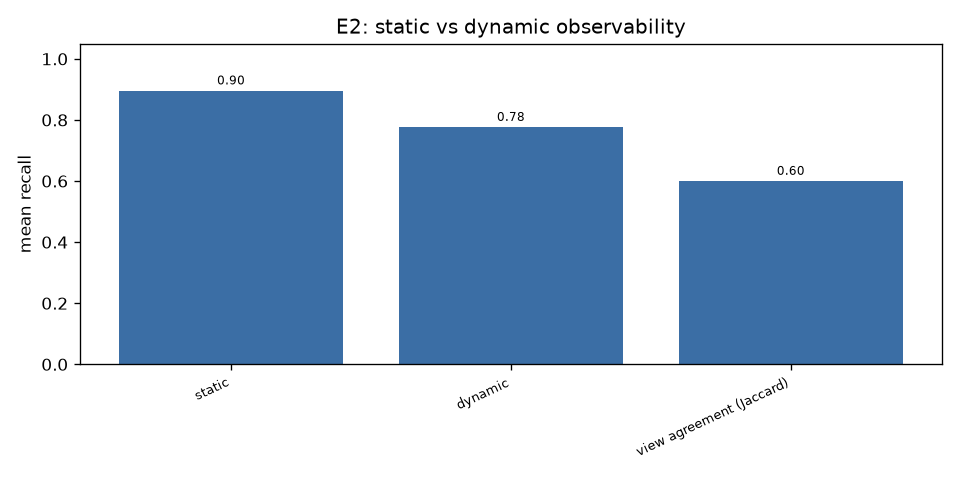
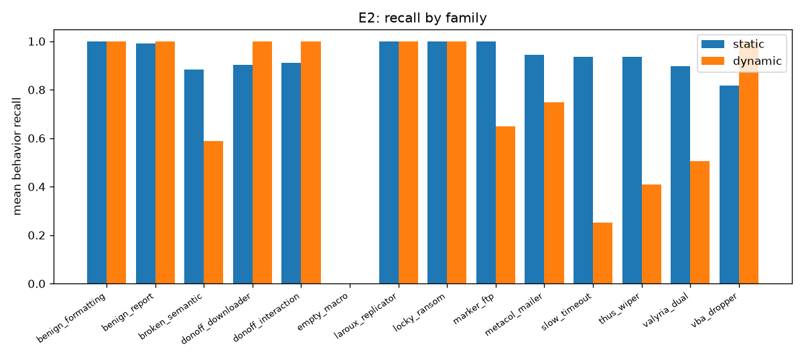
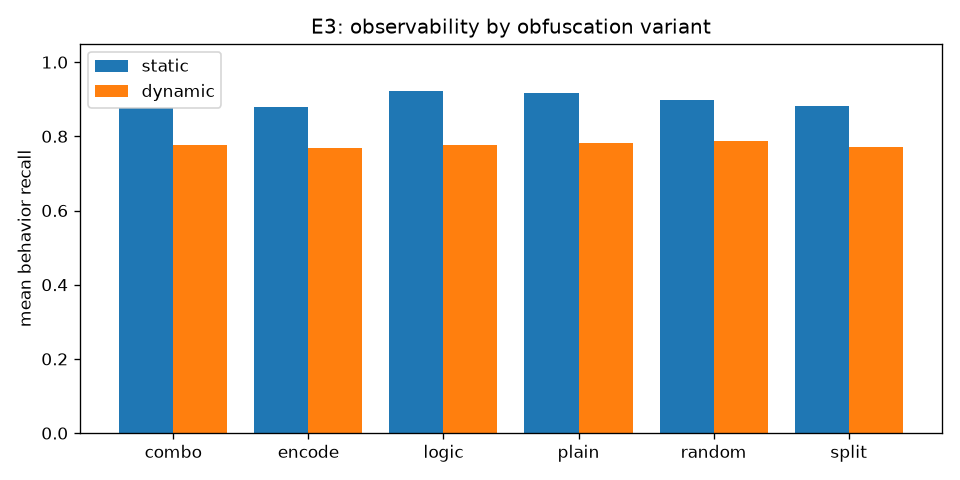
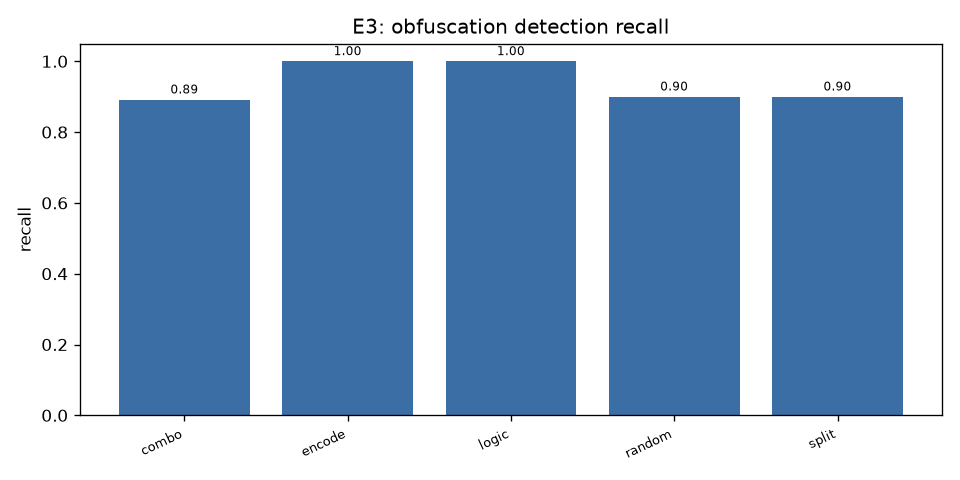
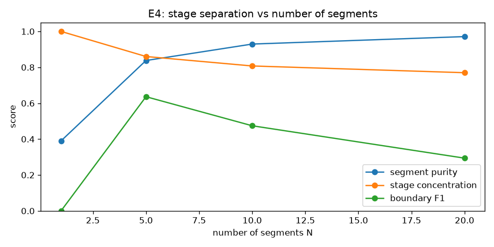
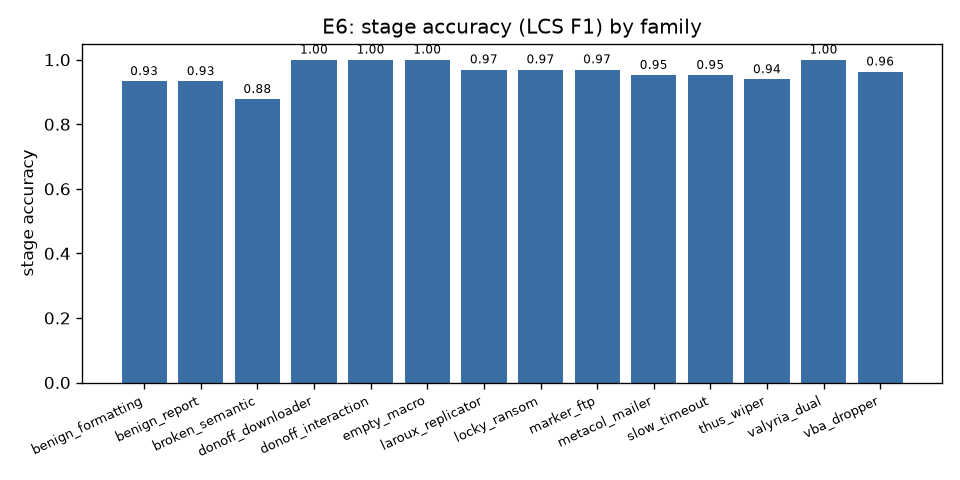
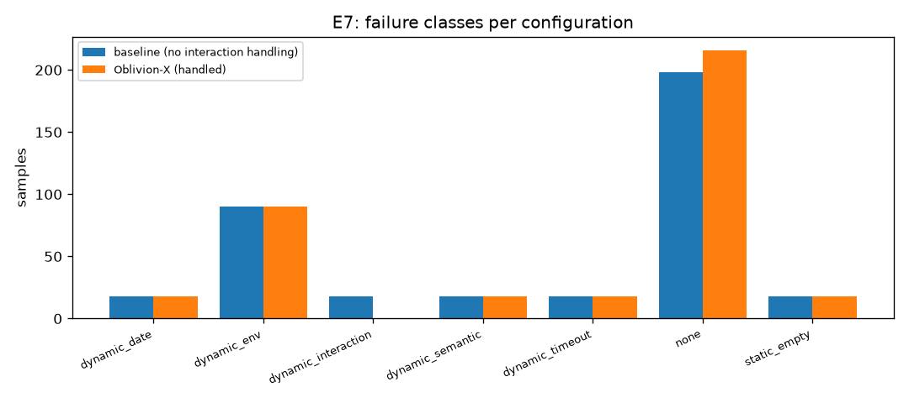
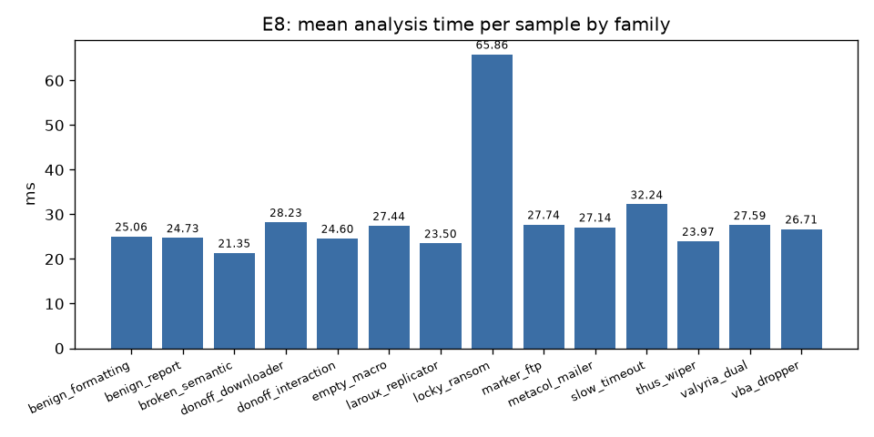

# Oblivion-X — Experiment Report

> Generated from `outputs/eval/E1..E8*.json`. Dynamic telemetry is produced by the deterministic Linux simulator unless stated otherwise; static analysis runs on the real Office files built by Word/Excel COM automation.

## E1 — Reproduce Oblivion (pre-processing taxonomy)

Oblivion's pre-processing classification applied to the 378-sample controlled corpus (cf. paper Table 1):

| Category | Count |
|---|---|
| empty | 18 |
| corrupted | 0 |
| interaction | 18 |
| cls | 0 |
| bas_cls | 342 |
| other | 0 |
| extracted | 900 |
| no_file | 0 |

- `extracted` counts modules, not samples (900 modules over 378 files).
- `empty` = the 18 `empty_macro` samples (project present, no code); `interaction` = the 18 MsgBox-gated samples; everything else is a standard `.bas + .cls` project.

## E2 — Static vs dynamic observability (RQ2)

| Measure | Value |
|---|---|
| Mean static behavior recall | 0.896 |
| Mean dynamic behavior recall | 0.777 |
| Mean view agreement (Jaccard) | 0.600 |

Behaviors seen by exactly one view (ground-truth only):

| Behavior | Static only | Dynamic only |
|---|---|---|
| file_write | 11 | 54 |
| outlook_send | 54 | 0 |
| shell_run | 54 | 0 |
| cmd_run | 50 | 0 |
| file_execute | 0 | 36 |
| url_reference | 30 | 0 |
| http_download | 26 | 0 |
| chr_encode | 18 | 0 |
| file_delete | 18 | 0 |
| dead_code | 18 | 0 |
| base64_encode | 18 | 0 |
| string_concat | 3 | 11 |

Reading: static analysis sees *intent* (URLs, `Outlook.Send`, `Shell`/`cmd` strings) even when the runtime gate never opens, while dynamic analysis sees *effects* of spawned processes (`file_write`/`file_execute` from PowerShell) that never appear in the VBA source. Neither view alone is sufficient.

## E3 — Obfuscation vs observability (RQ4)

| Variant | Static recall | Dynamic recall | Detection precision | Detection recall | Deobf. success |
|---|---|---|---|---|---|
| combo | 0.875 | 0.776 | 1.000 | 0.892 | 1.000 |
| encode | 0.880 | 0.768 | 1.000 | 1.000 | 1.000 |
| logic | 0.923 | 0.776 | 1.000 | 1.000 | n/a |
| plain | 0.918 | 0.781 | n/a | n/a | n/a |
| random | 0.899 | 0.787 | 1.000 | 0.900 | n/a |
| split | 0.882 | 0.772 | 1.000 | 0.900 | 0.900 |

- Detection precision is 1.0 for every technique: no plain sample trips a heuristic.
- Split/encode/combination detection misses the variants where the transform had too little material to rewrite (short macros); deobfuscation still recovers the hidden literal in 90-100% of the recoverable variants.
- Static recall barely changes across variants because the analyzer scans the obfuscated source directly; what drops is *literal* visibility (URLs, API names), which is why deobfuscation matters for reconstruction rather than for recall.

## E4 — Temporal segmentation stage separation (RQ3)

| N | Segment purity | Stage concentration | Boundary F1 | Boundary precision | Boundary recall |
|---|---|---|---|---|---|
| 1 | 0.390 | 1.000 | 0.000 | 0.000 | 0.000 |
| 5 | 0.838 | 0.860 | 0.636 | 0.820 | 0.545 |
| 10 | 0.929 | 0.807 | 0.474 | 0.754 | 0.369 |
| 20 | 0.971 | 0.770 | 0.294 | 0.581 | 0.204 |

- Best boundary F1 at **N=5** (0.636).
- Purity increases monotonically with N, but boundary F1 peaks at N=5: too many segments fragment stages and produce spurious boundaries. Bon-APT's fixed multi-scale configuration is therefore justified, but N=5 is the informative scale for this corpus.

## E5 — Controlled ground-truth validation

| Check | Pass rate |
|---|---|
| entry point | 1.000 |
| behavior hints | 1.000 |
| stage order | 1.000 |
| obfuscation label | 1.000 |

- 378 samples; entry-point mismatches 0, behavior-hint mismatches 0, stage-order mismatches 0.

## E6 — Stage reconstruction (RQ1, RQ5)

### All samples

| Metric | Value |
|---|---|
| Behavior recall | 0.981 |
| Behavior precision | 0.968 |
| Evidence precision | 1.000 |
| Stage accuracy (LCS F1) | 0.963 |
| Stage precision | 0.943 |
| Stage recall | 0.994 |
| Analysis completion rate | 0.952 |
| Execution success rate | 0.571 |
| Timeout rate | 0.048 |
| Deobfuscation success | 0.921 |
| Analysis time/sample (ms) | 0.1 |
| Unsupported behavior claim rate | 0.217 |

### Samples whose macro ran to completion

| Metric | Value |
|---|---|
| Behavior recall | 1.000 |
| Behavior precision | 0.969 |
| Evidence precision | 1.000 |
| Stage accuracy (LCS F1) | 0.964 |
| Stage precision | 0.938 |
| Stage recall | 1.000 |
| Analysis completion rate | 1.000 |
| Execution success rate | 1.000 |
| Timeout rate | 0.000 |
| Deobfuscation success | 1.000 |
| Analysis time/sample (ms) | 0.1 |
| Unsupported behavior claim rate | 0.031 |

### Per family

| Family | n | Behavior recall | Behavior precision | Stage accuracy | Stage precision | Stage recall |
|---|---|---|---|---|---|---|
| benign_formatting | 36 | 1.000 | 0.951 | 0.933 | 0.889 | 1.000 |
| benign_report | 36 | 1.000 | 0.958 | 0.933 | 0.889 | 1.000 |
| broken_semantic | 18 | 0.883 | 0.925 | 0.878 | 0.889 | 0.917 |
| donoff_downloader | 36 | 1.000 | 1.000 | 1.000 | 1.000 | 1.000 |
| donoff_interaction | 18 | 1.000 | 1.000 | 1.000 | 1.000 | 1.000 |
| empty_macro | 18 | 1.000 | 1.000 | 1.000 | 1.000 | 1.000 |
| laroux_replicator | 18 | 1.000 | 0.962 | 0.970 | 0.944 | 1.000 |
| locky_ransom | 36 | 1.000 | 0.962 | 0.970 | 0.944 | 1.000 |
| marker_ftp | 36 | 1.000 | 0.966 | 0.970 | 0.944 | 1.000 |
| metacol_mailer | 18 | 1.000 | 0.951 | 0.952 | 0.917 | 1.000 |
| slow_timeout | 18 | 0.935 | 0.942 | 0.952 | 0.917 | 1.000 |
| thus_wiper | 18 | 0.935 | 0.948 | 0.939 | 0.933 | 0.958 |
| valyria_dual | 36 | 0.927 | 1.000 | 1.000 | 1.000 | 1.000 |
| vba_dropper | 36 | 1.000 | 0.962 | 0.963 | 0.933 | 1.000 |

Reading: on samples that actually execute, behavior recall is 1.0 and stage accuracy ~0.96. The gap on the full set comes from environment-gated families whose later stages never run: the reconstructor correctly reports only the observable prefix and marks the rest unsupported instead of inventing it.

## E7 — Failure analysis

| Failure class | Baseline | Oblivion-X (handled) |
|---|---|---|
| dynamic_date | 18 | 18 |
| dynamic_env | 90 | 90 |
| dynamic_interaction | 18 | 0 |
| dynamic_semantic | 18 | 18 |
| dynamic_timeout | 18 | 18 |
| none | 198 | 216 |
| static_empty | 18 | 18 |

- Expectation mismatches: handled **0**, baseline **0**.
- Interaction handling recovered **18** of 18 interaction-gated samples.
- `dynamic_env` (Outlook/FTP absent), `dynamic_date` (date gate), `dynamic_semantic` (broken macro) and `dynamic_timeout` are not fixed by interaction handling: they are genuine environment or sample limitations and are reported as such.

## E8 — Performance / resource analysis

| Measure | Value |
|---|---|
| Samples | 378 |
| Mean time/sample (ms) | 30.1 |
| Std (ms) | 66.8 |
| p50 (ms) | 24.9 |
| p95 (ms) | 40.2 |
| Throughput (samples/s) | 33.2 |
| Static time/sample (ms) | 30.0 |
| Simulator time/sample (ms) | 0.1 |
| Completion rate | 0.952 |
| Timeout rate | 0.048 |

> dynamic_time_ms is the cost of the deterministic telemetry simulator; real Office execution time is reported separately when --dynamic-source windows traces are used.

## Figures

