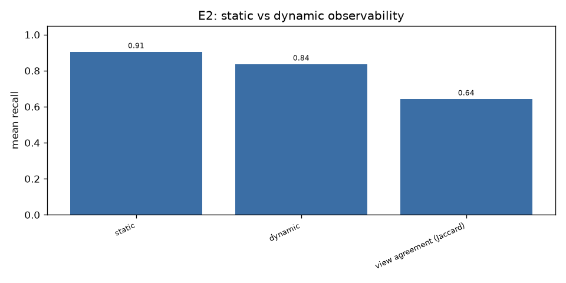
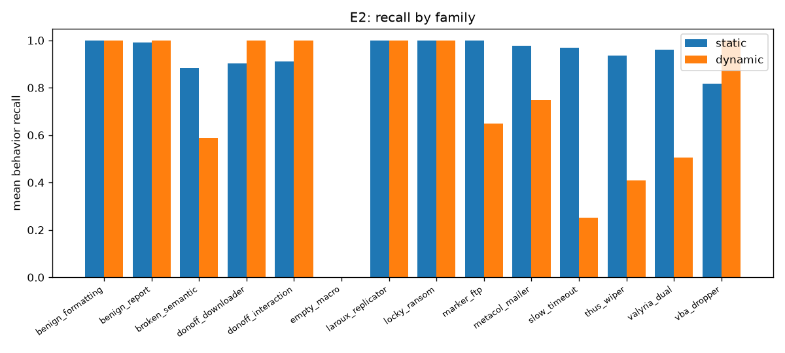
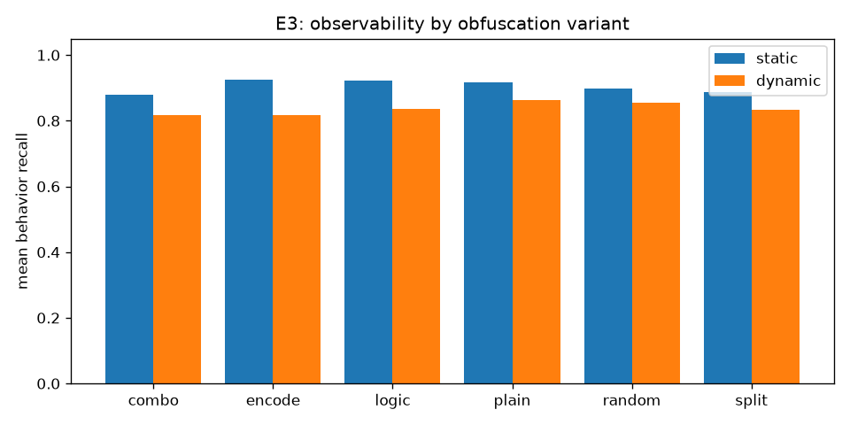
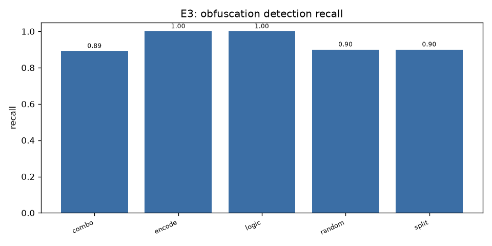
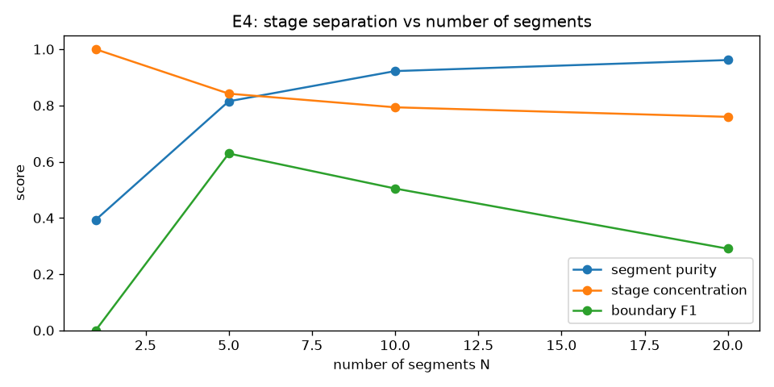
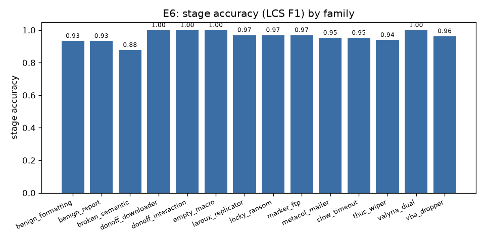
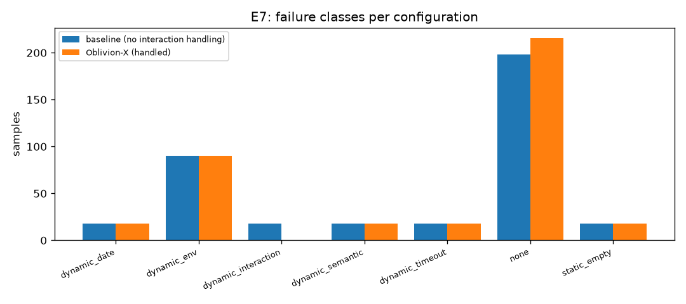
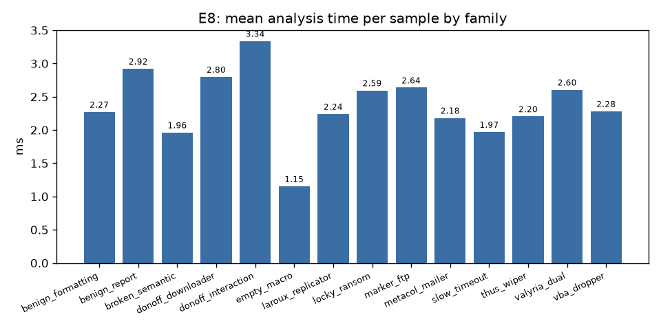
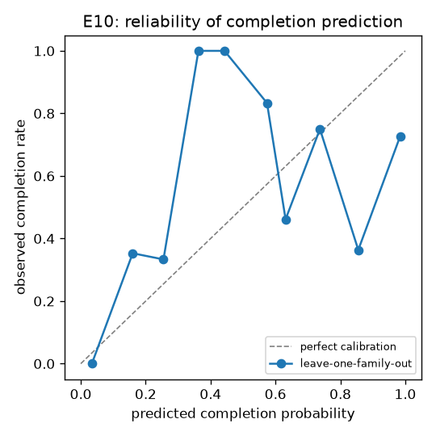

# Oblivion-X — Experiment Report

> Generated from the E1..E8 JSON artifacts. Dynamic telemetry is produced by the deterministic Linux simulator unless stated otherwise; static analysis runs on the corpus Office files (Word/Excel COM-authored or offline-built with the pure-Python MS-OVBA writer).

## E1 — Reproduce Oblivion (pre-processing taxonomy)

Oblivion's pre-processing classification applied to the 378-sample controlled corpus (cf. paper Table 1):

| Category | Count |
|---|---|
| empty | 18 |
| corrupted | 0 |
| interaction | 18 |
| cls | 0 |
| bas_cls | 342 |
| other | 0 |
| extracted | 900 |
| no_file | 0 |

- `extracted` counts modules, not samples (900 modules over 378 files).
- `empty` = the 18 samples whose project has no executable code; `interaction` = the 18 MsgBox-gated samples; everything else is a standard `.bas + .cls` project.

## E2 — Static vs dynamic observability (RQ2)

| Measure | Value |
|---|---|
| Mean static behavior recall | 0.905 |
| Mean dynamic behavior recall | 0.837 |
| Mean view agreement (Jaccard) | 0.643 |

Behaviors seen by exactly one view (ground-truth only):

| Behavior | Static only | Dynamic only |
|---|---|---|
| file_write | 10 | 54 |
| outlook_send | 54 | 0 |
| file_execute | 0 | 36 |
| chr_encode | 18 | 0 |
| base64_encode | 18 | 0 |
| dead_code | 18 | 0 |
| file_delete | 18 | 0 |
| shell_run | 18 | 0 |
| cmd_run | 17 | 0 |
| string_concat | 3 | 11 |
| env_read | 8 | 0 |
| url_reference | 0 | 6 |

Reading: static analysis sees *intent* (URLs, `Outlook.Send`, `Shell`/`cmd` strings) even when the runtime gate never opens, while dynamic analysis sees *effects* of spawned processes (`file_write`/`file_execute` from PowerShell) that never appear in the VBA source. Neither view alone is sufficient.

## E3 — Obfuscation vs observability (RQ4)

| Variant | Static recall | Dynamic recall | Detection precision | Detection recall | Deobf. success |
|---|---|---|---|---|---|
| combo | 0.879 | 0.818 | 1.000 | 0.892 | 1.000 |
| encode | 0.926 | 0.817 | 1.000 | 1.000 | 1.000 |
| logic | 0.923 | 0.835 | 1.000 | 1.000 | n/a |
| plain | 0.918 | 0.862 | n/a | n/a | n/a |
| random | 0.899 | 0.854 | 1.000 | 0.900 | n/a |
| split | 0.887 | 0.834 | 1.000 | 0.900 | 0.900 |

- Detection precision is 1.0 for every technique: no plain sample trips a heuristic.
- Split/encode/combination detection misses the variants where the transform had too little material to rewrite (short macros); deobfuscation still recovers the hidden literal in 90%-100% of the recoverable variants.
- Static recall barely changes across variants because the analyzer scans the obfuscated source directly; what drops is *literal* visibility (URLs, API names), which is why deobfuscation matters for reconstruction rather than for recall.

## E4 — Temporal segmentation stage separation (RQ3)

| N | Segment purity | Stage concentration | Boundary F1 | Boundary precision | Boundary recall | Pk | WindowDiff |
|---|---|---|---|---|---|---|---|
| 1 | 0.393 | 1.000 | 0.000 | 0.000 | 0.000 | 0.870 | 0.643 |
| 5 | 0.815 | 0.842 | 0.629 | 0.845 | 0.525 | 0.299 | 0.291 |
| 10 | 0.922 | 0.793 | 0.505 | 0.783 | 0.395 | 0.133 | 0.151 |
| 20 | 0.962 | 0.760 | 0.290 | 0.587 | 0.201 | 0.053 | 0.079 |

- Best boundary F1 at **N=5** (0.629).
- Pk and WindowDiff are the reference text-segmentation measures (lower is better). They keep improving with N because finer buckets approximate the truth more closely in window terms, which shows that a single fixed N is a trade-off rather than an optimum; the boundary F1 peak at N=5 is the scale at which whole stages fit inside a bucket.
- **Change-point estimate** (BIC-style penalty, held out from the labels): mean estimated segments 2.696 vs mean ground-truth stages 3.349; exact agreement 0.156, mean absolute error 1.791. The estimator never sees the ground truth, so this asks whether N can be *found* instead of swept.
- **Permutation null** at N=5: observed purity 0.744 vs shuffled order 0.681 (mean z = 0.909); 0.000 of samples reach p < 0.01. A z near 1 means the stage separation at this scale is only marginally better than chance, which tempers the boundary-F1 headline.

## E5 — Controlled ground-truth validation

| Check | Pass rate |
|---|---|
| entry point | 1.000 |
| behavior hints | 1.000 |
| stage order | 1.000 |
| obfuscation label | 1.000 |

- 378 samples; entry-point mismatches 0, behavior-hint mismatches 0, stage-order mismatches 0.

## E6 — Stage reconstruction (RQ1, RQ5)

### All samples

| Metric | Value |
|---|---|
| Behavior recall | 0.990 |
| Behavior precision | 0.968 |
| Evidence precision | 1.000 |
| Stage accuracy (LCS F1) | 0.963 |
| Stage precision | 0.943 |
| Stage recall | 0.994 |
| Analysis completion rate | 0.952 |
| Execution success rate | 0.571 |
| Timeout rate | 0.048 |
| Deobfuscation success | 0.967 |
| Analysis time/sample (ms) | 2.4 |
| Unsupported behavior claim rate | 0.151 |

### Samples whose macro ran to completion

| Metric | Value |
|---|---|
| Behavior recall | 1.000 |
| Behavior precision | 0.969 |
| Evidence precision | 1.000 |
| Stage accuracy (LCS F1) | 0.964 |
| Stage precision | 0.938 |
| Stage recall | 1.000 |
| Analysis completion rate | 1.000 |
| Execution success rate | 1.000 |
| Timeout rate | 0.000 |
| Deobfuscation success | 1.000 |
| Analysis time/sample (ms) | 2.6 |
| Unsupported behavior claim rate | 0.031 |

### Per family

| Family | n | Behavior recall | Behavior precision | Stage accuracy | Stage precision | Stage recall |
|---|---|---|---|---|---|---|
| benign_formatting | 36 | 1.000 | 0.951 | 0.933 | 0.889 | 1.000 |
| benign_report | 36 | 1.000 | 0.958 | 0.933 | 0.889 | 1.000 |
| broken_semantic | 18 | 0.883 | 0.925 | 0.878 | 0.889 | 0.917 |
| donoff_downloader | 36 | 1.000 | 1.000 | 1.000 | 1.000 | 1.000 |
| donoff_interaction | 18 | 1.000 | 1.000 | 1.000 | 1.000 | 1.000 |
| empty_macro | 18 | 1.000 | 1.000 | 1.000 | 1.000 | 1.000 |
| laroux_replicator | 18 | 1.000 | 0.962 | 0.970 | 0.944 | 1.000 |
| locky_ransom | 36 | 1.000 | 0.962 | 0.970 | 0.944 | 1.000 |
| marker_ftp | 36 | 1.000 | 0.966 | 0.970 | 0.944 | 1.000 |
| metacol_mailer | 18 | 1.000 | 0.951 | 0.952 | 0.917 | 1.000 |
| slow_timeout | 18 | 0.968 | 0.947 | 0.952 | 0.917 | 1.000 |
| thus_wiper | 18 | 0.935 | 0.948 | 0.939 | 0.933 | 0.958 |
| valyria_dual | 36 | 1.000 | 1.000 | 1.000 | 1.000 | 1.000 |
| vba_dropper | 36 | 1.000 | 0.962 | 0.963 | 0.933 | 1.000 |

Reading: on samples that actually execute, behavior recall is 1.000 and stage accuracy 0.964. The gap on the full set comes from environment-gated families whose later stages never run: the reconstructor correctly reports only the observable prefix and marks the rest unsupported instead of inventing it.

## E7 — Failure analysis

| Failure class | Baseline | Oblivion-X (handled) |
|---|---|---|
| dynamic_date | 18 | 18 |
| dynamic_env | 90 | 90 |
| dynamic_interaction | 18 | 0 |
| dynamic_semantic | 18 | 18 |
| dynamic_timeout | 18 | 18 |
| none | 198 | 216 |
| static_empty | 18 | 18 |

- Expectation mismatches: handled **0**, baseline **0**.
- Interaction handling recovered **18** of 18 interaction-gated samples.
- `dynamic_env` (Outlook/FTP absent), `dynamic_date` (date gate), `dynamic_semantic` (broken macro) and `dynamic_timeout` are not fixed by interaction handling: they are genuine environment or sample limitations and are reported as such.

## E8 — Performance / resource analysis

| Measure | Value |
|---|---|
| Samples | 378 |
| Mean time/sample (ms) | 2.4 |
| Std (ms) | 0.8 |
| p50 (ms) | 2.3 |
| p95 (ms) | 3.7 |
| Throughput (samples/s) | 409.7 |
| Static time/sample (ms) | 2.4 |
| Simulator time/sample (ms) | 0.1 |
| Completion rate | 0.952 |
| Timeout rate | 0.048 |

> dynamic_time_ms is the cost of the deterministic telemetry simulator; real Office execution time is reported separately when --dynamic-source windows traces are used.

## E9 — Chain-order ablation: ontology vs evidence (RQ5)

| Ordering | Stage accuracy | Precision | Recall | Exact-match rate |
|---|---|---|---|---|
| ontology | 0.963 | 0.943 | 0.994 | 0.746 |
| timestamp | 0.854 | 0.836 | 0.882 | 0.508 |

- The two orderings use the same events and produce the same set of stages; only the order differs. They disagree on **161/378** samples and the accuracy delta (timestamp − ontology) is **-0.109**.
- An exact-match rate of 0.746 under ontology ordering is partly true by construction. Under evidence ordering it is 0.508, which is the number that shows the chronological chain is recovered from observations rather than assumed.
- The residual gap is informative: recovered literals can add a stage that no telemetry ever observed (`url_reference` from a deobfuscated blob lands in `c2_download`). Under ontology ordering it is silently slotted into its canonical position; under evidence ordering it is visible as an untimed stage, which is the honest reading — static evidence is *intent*, not an observed event.

## E10 — Calibration of completion prediction (extension)

| Measure | Value |
|---|---|
| Samples | 378 |
| Base rate (completed) | 0.571 |
| AUC (leave-one-family-out) | 0.669 |
| Brier | 0.242 |
| Brier baseline | 0.245 |
| Brier skill | 0.014 |
| ECE (10 bins) | 0.234 |
| AUC, in-sample (reference) | 1.000 |

Reliability (equal-width probability bins):

| Predicted bin | n | Mean predicted | Observed rate |
|---|---|---|---|
| 0.0–0.1 | 55 | 0.034 | 0.000 |
| 0.1–0.2 | 17 | 0.160 | 0.353 |
| 0.2–0.3 | 9 | 0.255 | 0.333 |
| 0.3–0.4 | 9 | 0.363 | 1.000 |
| 0.4–0.5 | 6 | 0.443 | 1.000 |
| 0.5–0.6 | 18 | 0.574 | 0.833 |
| 0.6–0.7 | 13 | 0.631 | 0.462 |
| 0.7–0.8 | 24 | 0.737 | 0.750 |
| 0.8–0.9 | 33 | 0.855 | 0.364 |
| 0.9–1.0 | 194 | 0.984 | 0.727 |

By failure mechanism (family counts show whether the cause can generalise):

| Mechanism | n | Families | Observed completed | Mean predicted |
|---|---|---|---|---|
| dynamic_date | 18 | 1 | 0.000 | 0.892 |
| dynamic_env | 90 | 3 | 0.000 | 0.451 |
| dynamic_semantic | 18 | 1 | 0.000 | 0.765 |
| dynamic_timeout | 18 | 1 | 0.000 | 0.827 |
| none | 216 | 7 | 1.000 | 0.844 |
| static_empty | 18 | 1 | 0.000 | 0.033 |

- Static evidence predicts completion only when the blocking mechanism generalises across families. Empty projects are predicted almost perfectly (0.03) and Outlook-gated families are predicted low because another family also references Outlook; FTP, date gates, busy loops and runtime errors occur in a single family each, so a held-out family regresses to the base rate.
- The gap between the in-sample AUC (1.000) and the leave-one-family-out AUC (0.669) is the amount of family composition the model would memorise. The out-of-fold Brier skill (0.014) is barely positive: an analyst cannot reliably anticipate the unsupported-claim rate from static evidence alone, which is precisely why the pipeline measures and reports it instead of estimating it.

## Figures

